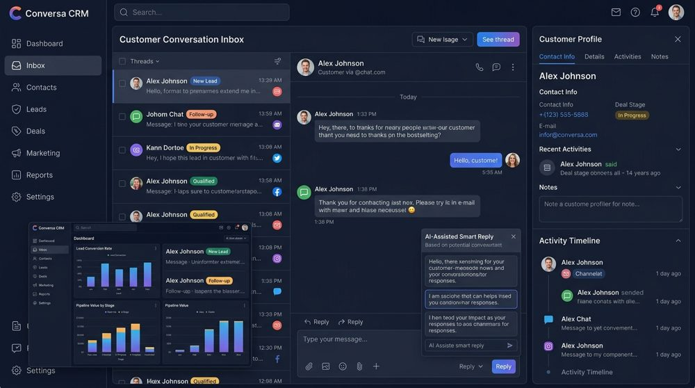
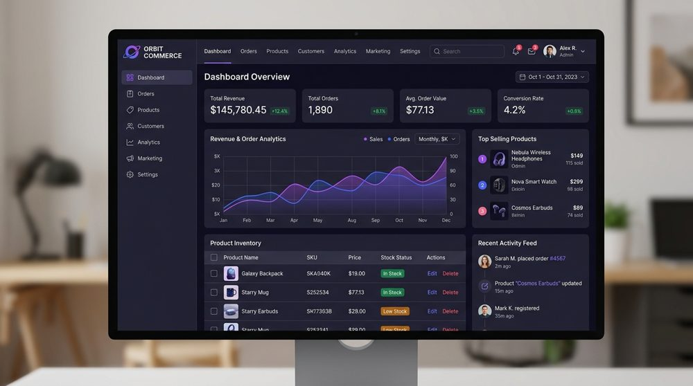

## 👋 About Pixel Syntax

**Pixel Syntax** is a software development studio based in **Dubai, UAE** 🇦🇪. We build custom software, CRM systems, web applications, business websites and AI automation for companies across the UAE and worldwide.

- 🚀 We build **production systems that run real businesses every day**
- ⚡ Clean architecture, fast performance and smooth motion design
- 🤖 AI built into the product: smart replies, document reading and automated workflows
- 🕐 We reply to every enquiry **within 12 hours**

## 🛠️ What We Build

| | Service | What you get |
|:-:|---|---|
| 💬 | **CRM & WhatsApp Automation** | AI auto-replies, lead scoring, a live chat inbox, templates and team management |
| 🚚 | **Operations & ERP Software** | Fleet, delivery, payroll, HR and document management in one portal |
| 🌐 | **Web Applications & SaaS** | Custom dashboards, client portals and multi-user platforms |
| 🛒 | **E-Commerce** | Fast storefronts, Stripe checkout and admin control |
| 🎨 | **Business & Portfolio Websites** | Fast, SEO-ready sites with GSAP animations |
| 🤖 | **AI Integrations** | Gemini/OpenAI-powered assistants, document extraction and automation |
| ☁️ | **Cloud & DevOps** | Cloudflare, Netlify, Vercel, CI/CD, DNS and SSL |

## ✨ Featured Work

<table>
<tr>
<td width="50%" valign="top">

### 💬 AI WhatsApp CRM
An enterprise WhatsApp CRM with **AI auto-replies, lead scoring, a live chat inbox, templates, analytics and team management**.

`React` `TypeScript` `Supabase` `Gemini AI` `Netlify`

</td>
<td width="50%" valign="top">

### 🚚 Pixel Syntax Delivery Software
A complete **fleet and delivery operations portal**: riders, vehicles, SIMs, attendance, payroll workbooks and documents, with AI document reading.

🔗 **Live demo:** [deliverysoftwarepixel.site](https://deliverysoftwarepixel.site)

`React` `Cloudflare Workers` `R2` `Supabase` `ExcelJS`

</td>
</tr>
<tr>
<td width="50%" valign="top">

### 🛒 Orbit Commerce
A high-performance e-commerce experience with an immersive storefront, streamlined checkout and commerce analytics.

`Next.js` `Stripe` `Tailwind CSS`

</td>
<td width="50%" valign="top">

### 🎬 Little Story Studio
An AI kids-story video maker: write a scene, pick a character's outfit and background, add a voice and export a short animated video.

`JavaScript` `Cloudflare Workers` `AI Voice`

### 🌐 pixelsyntax.store
Our own studio website, with an AI assistant, GSAP and Lenis motion, a CMS and an analytics pipeline.

🔗 [pixelsyntax.store](https://pixelsyntax.store)

</td>
</tr>
</table>

> 🔒 Client projects and production source code stay **private** to protect our clients. Want a live demo? [Get in touch →](mailto:info@pixelsyntax.store)

## 🧰 Tech Stack

## 🤝 Work With Us

**Have a project in mind? Let's build it.**

© Pixel Syntax · Dubai, United Arab Emirates · Code today for a smarter tomorrow

